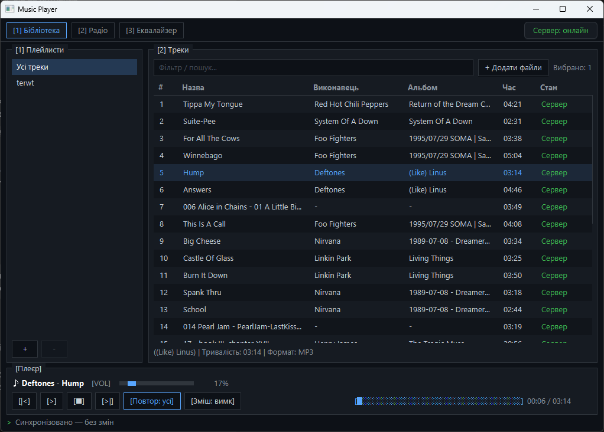

# 🎵 Music Player


# 💡 Ідея
Ідея проєкту - спрощена модель домашнього стрімінгу. Централізований сервер зберігає музичну
бібліотеку, а клієнт надає до неї доступ будь-де: треки автоматично кешуються локально, тож
плеєр повноцінно працює й без сервера, а при відновленні зв'язку бібліотека синхронізується
у фоновому режимі.

Інтерфейс свідомо імітує консольну естетику: темна палітра GitHub-dark, моноширинний шрифт,
панелі з рамками та підписами у квадратних дужках, текстовий прогрес-бар `[████]` і
кліпаючий курсор у статусному рядку - але під капотом це повноцінний графічний застосунок JavaFX.

## 📸 Скріншот



## ✨ Основні можливості

### ⚙️ Керування бібліотекою і плейлистами

- пошук та фільтрація треків у реальному часі (назва, виконавець, альбом, файл);
- групове виділення треків для **масового завантаження на сервер** або видалення
  (з сервера чи локально) з підсумками операції;
- перемикання плейлистів **без зупинки поточного відтворення** (перегляд плейлиста окремий від
  активації черги відтворення);
- взаємовиключні режими повтору (`усі` / `один`) і перемішування;
- створення та видалення плейлистів; «Усі треки» - базовий плейлист, до якого потрапляє все.

### 🔄 Синхронізація та офлайн-режим

- автоматична **фонова синхронізація** при запуску та після додавання файлів; ручна - кліком
  на індикатор сервера;
- статуси треків: **`Сервер`** · **`Кеш`** · **`Локально`**;
- локальний кеш у `~/musicplayer-cache/` (файли `track-<id>.<ext>`); відсутні треки автоматично
  підтягуються з сервера перед відтворенням;
- офлайн-режим: індикатор «Сервер: офлайн», повідомлення «Сервер недоступний - працюємо локально»,
  відкладені видалення плейлистів (повторюються при наступній синхронізації);
- дедуплікація треків за шляхом, нормалізованою назвою файлу або парою «виконавець + назва + тривалість».

### ▶️ Відтворення

- формати **MP3, WAV, FLAC, OGG, AIFF, AU** - декодування через Java Sound SPI
  (`mp3spi`, `vorbisspi`, `jflac-codec`) з приведенням до 16-бітного PCM;
- відтворення, пауза, перемотування кліком по прогрес-бару, гучність, автоперехід до наступного треку;
- відновлення позиції, гучності, режимів та налаштувань еквалайзера після перезапуску.

### 📡 Радіо

- п'ять вбудованих пресетів (SomaFM Groove Salad / Drone Zone / DEF CON, FIP, Radio Paradise);
- асинхронний пошук станцій через [radio-browser.info](https://www.radio-browser.info)
  (за назвою або тегом);
- підключення до довільної URL-адреси потоку з індикацією `ПОТІК / LIVE`.

### 🎛 Еквалайзер

- три смуги - **Низькі / Середні / Високі**, діапазон **−12…+12 дБ**, крок 1 дБ;
- пресети: **Плоский**, **Бас**, **Вокал**, **Високі** та кнопка скидання;

## 🏛 Архітектура

| Модуль | Призначення |
|---|---|
| **`player-core`** | Доменна логіка та бізнес-правила: відтворення (Java Sound), модель бібліотеки, черга відтворення, SQLite-сховище, REST-синхронізація, радіо |
| **`player-ui`** | JavaFX-інтерфейс у стилі TUI, залежить лише від `player-core`, не навпаки |

Пакети `player-core` (базовий - `ua.kpi.musicplayer`):

| Пакет | Вміст |
|---|---|
| `audio` | `SimpleAudioPlayer`, `AudioMetadataReader`, `Equalizer` |
| `facade` | `MusicPlayerFacade` |
| `model` | `Track`, `Playlist` |
| `playback` | `PlaybackQueue`, `TrackIterator`, `QueueTrackIterator` |
| `observer` | `PlayerObserver`, `PlayerState` |
| `memento` | `PlayerMemento` |
| `visitor` | `MediaInfoVisitor`, `SummaryMediaVisitor` |
| `stream` | `RadioStation`, `RadioBrowserClient` |
| `sync` | `TrackSyncClient`, `PlaylistSyncClient` |
| `storage` | `TrackStorage` |

## 🧩 Шаблони проєктування

| Патерн | Реалізація | Застосування |
|---|---|---|
| **Facade** | `MusicPlayerFacade` | єдина точка доступу UI до відтворення, бібліотеки, кешу та синхронізації |
| **Iterator** | `TrackIterator` + `QueueTrackIterator` | обхід черги відтворення, послідовний, з повтором, зі перемішуванням |
| **Observer** | `PlayerObserver` + `PlayerState` | реакція інтерфейсу на зміни стану відтворення |
| **Memento** | `PlayerMemento` | збереження/відновлення стану плеєра (позиція, гучність, режими, еквалайзер) |
| **Visitor** | `MediaInfoVisitor` + `SummaryMediaVisitor` | форматування відомостей про трек і радіостанцію |

## 🛠 Технології

| Технологія | Роль |
|---|---|
| **Java 25** | мова та платформа (`maven.compiler.release=25`) |
| **JavaFX 25** | графічний інтерфейс (`javafx-controls`) |
| **Java Sound + SPI** | декодування та відтворення: `mp3spi 1.9.5.4`, `vorbisspi 1.0.3.3`, `jflac-codec 1.5.2` |
| **SQLite** | локальна база бібліотеки (`sqlite-jdbc 3.54.1.0`) |
| **`java.net.http`** | REST-клієнт синхронізації, JSON - власний мінімальний парсер, без сторонніх бібліотек |
| **Maven** | збірка, `javafx-maven-plugin 0.0.8` для запуску клієнта |

## 🌐 Взаємодія з сервером

Клієнт працює з медіасервером **`player-coursework-server`**, за замовчуванням
`http://localhost:8080`:

| Метод | Ендпоінт | Призначення |
|---|---|---|
| `GET` | `/tracks` | список треків на сервері |
| `POST` | `/tracks/upload` | завантаження файлу (multipart/form-data) |
| `GET` | `/tracks/{id}/file` | завантаження файлу у локальний кеш |
| `DELETE` | `/tracks/{id}` | видалення треку з сервера |
| `GET` | `/playlists` | список віддалених плейлистів |
| `POST` | `/playlists` | створення/оновлення плейлиста (JSON) |
| `DELETE` | `/playlists/{id}` | видалення плейлиста |

Синхронізація **двостороння**: локальні треки завантажуються на сервер, віддалені - качаються
в кеш, плейлисти узгоджуються в обидва боки. Якщо сервер недоступний, клієнт продовжує
повноцінно працювати локально.

## 📁 Локальні дані

| Шлях | Призначення |
|---|---|
| `~/musicplayer.db` | SQLite-база: треки, плейлисти, зв'язки, відкладені видалення |
| `~/musicplayer-cache/` | кеш аудіофайлів, завантажених із сервера |
| `~/musicplayer-state.properties` | збережений стан плеєра (Memento) |

## 🚀 Збірка та запуск

**Вимоги:** JDK 25, Apache Maven. Сервер `player-coursework-server` - необов'язковий
(без нього клієнт працює в локальному режимі).

```bash
# 1. Зібрати та встановити модулі у локальний репозиторій Maven
mvn install -DskipTests

# 2. Запустити JavaFX-клієнт
mvn -pl player-ui javafx:run
```

Перевірка збірки без запуску: `mvn test-compile` з кореня проєкту.

Додатково: у `player-core` є консольний демо-плеєр `ua.kpi.musicplayer.Main` - приймає шлях до
аудіофайлу аргументом і відтворює його без графічного інтерфейсу.

## ⌨️ Гарячі клавіші

| Клавіша | Дія |
|---|---|
| `1`–`3` | перемикання вкладок Бібліотека / Радіо / Еквалайзер |
| `Enter` | відтворити вибраний трек |
| подвійний клік | відтворити трек / підключити радіостанцію |

## 📂 Структура проєкту

```
player-coursework-client/
├── pom.xml                          
├── player-core/                     #
│   └── src/main/java/ua/kpi/musicplayer/
│       ├── Main.java                # консольний демо-плеєр
│       ├── audio/                   # відтворення, метадані, еквалайзер
│       ├── facade/                  # MusicPlayerFacade
│       ├── model/                   # Track, Playlist
│       ├── playback/                # черга та ітератори
│       ├── observer/                # спостерігачі стану
│       ├── memento/                 # збереження стану
│       ├── visitor/                 # форматувачі
│       ├── stream/                  # радіо
│       ├── sync/                    # REST-синхронізація з сервером
│       └── storage/                 # SQLite-сховище
└── player-ui/                       # JavaFX-клієнт
    └── src/main/
        ├── java/ua/kpi/musicplayer/ui/    # MusicPlayerApplication, MainView
        └── resources/ua/kpi/musicplayer/ui/styles.css
```

